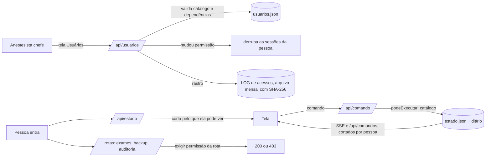

# Permissões — mapa de hoje e arquitetura proposta

Proposta de 13/10/2026. **Nada disto está implementado ainda**: aguarda aprovação e as decisões da seção 5.

**Pedido:** mapear todas as permissões do sistema; o **Anestesista chefe** é o único que cadastra usuários e
decide quais permissões cada um terá.

**Resumo da proposta:**

- Os 3 perfis fixos de hoje viram **29 permissões** nomeadas, num catálogo único em `core/12b_permissoes.js`.
- Cada usuário tem a **sua** lista de permissões, escolhida pelo chefe. "Anestesista" e "Secretária" passam a
  ser **modelos**: o chefe aplica um modelo e liga ou desliga o que quiser.
- **Só o chefe** cadastra usuários e define permissões. Isso não é uma permissão que se possa dar a outra
  pessoa: fica preso ao perfil chefe, junto com as operações que apagam ou substituem os dados de todos.
- O **servidor** continua sendo quem decide. A tela só esconde o que a pessoa não pode usar.
- **No dia da troca, ninguém ganha nem perde acesso**: cada usuário recebe exatamente as permissões do perfil
  que tem hoje.

---

## 1. Como é hoje (mapa completo)

Tudo vem de uma tabela só (`core/12b_permissoes.js`), lida pelo servidor, pela tela e pelos testes.

### 1.1 Telas

| Tela | Chefe | Anestesista | Secretária |
|---|:-:|:-:|:-:|
| Painel, Escala, Quadro do dia, Cirurgias, Avaliações pré | ✓ | ✓ | ✓ |
| Boletim anestésico | ✓ | ✓ | ✓ (só vê e imprime) |
| Qualidade (ficha) | ✓ | ✓ | ✓ |
| Painel de qualidade | ✓ | ✓ (sem comparar profissionais) | — |
| Horas, Financeiro, Repasse, Indicadores | ✓ | — | ✓ |
| Estrutura | ✓ | — | — |
| Anestesistas (cadastro), Clínica e termo | ✓ | — | ✓ |
| Integridade, Auditoria (LOG), Dados e backup | ✓ | — | — |
| Usuários (só no servidor) | ✓ | — | — |

### 1.2 Operações que mudam dados (35)

| Grupo | Operações | Chefe | Anestesista | Secretária |
|---|---|:-:|:-:|:-:|
| Operação | adicionarCirurgia, atualizarCirurgia, removerCirurgia, atualizarAvaliacao, ajustarEscala, aplicarRemanejamento | ✓ | ✓ | ✓ |
| Cadastro | salvarAnestesista, definirEscalaBase, definirModoEscalaBase, salvarConfigClinica | ✓ | — | ✓ |
| Financeiro | salvarDespesasRepasse, registrarPagamentoRepasse, removerPagamentoRepasse, atualizarParticipantesRepasse | ✓ | — | ✓ |
| Boletim | criarBoletim, salvarBoletim, alterarLinhaBoletim, finalizarBoletim, reabrirBoletim, descartarBoletim | ✓ | ✓ | — |
| Qualidade | criarFichaQualidade, salvarFichaQualidade, preencherFichaDoBoletim, alterarEventoQualidade, registrarSeguimentoQualidade, revisarFichaQualidade, concluirFichaQualidade, reabrirFichaQualidade, descartarFichaQualidade | ✓ | ✓ | ✓ |
| Coordenação | salvarRegistroEstrutura, removerRegistroEstrutura, salvarConfigQualidade | ✓ | — | — |
| Sistema | reparar, salvarConfigLog | ✓ | — | — |
| Interna | arquivarLogAte (só o próprio servidor) | — | — | — |

Regras que valem junto:

- Operação nova que não esteja na tabela **nasce fechada**: só o chefe a faz (teste em `qa/25`).
- Assinar o boletim (`finalizarBoletim`) exige que o login esteja ligado a um anestesista do cadastro, e o
  boletim sai no nome e no CRM dele (`contextoDeAssinatura`).

### 1.3 Dados que o servidor corta

| Dado | Chefe | Anestesista | Secretária |
|---|:-:|:-:|:-:|
| Valor, pago, data do pagamento e NF (cirurgias e avaliações) | ✓ | — | ✓ |
| Repasses | ✓ | — | ✓ |
| PIX, telefone e e-mail dos anestesistas | ✓ | — | ✓ |
| LOG de auditoria | ✓ | — | — |

O corte vale no estado (`projetarEstadoParaPerfil`), nos comandos que cada tela reexecuta
(`redigirComandoParaPerfil`) e nos avisos ao vivo (SSE).

### 1.4 Rotas do servidor

| Rota | Quem |
|---|---|
| `/api/saude`, `/api/eu`, `/api/entrar`, `/api/primeiro-acesso`, `/api/sair` | Qualquer um (antes do login) |
| `/api/estado`, `/api/comando`, `/api/comandos`, `/api/eventos` | Quem entrou, cortado ou conferido pelo perfil |
| `/api/anexos` (listar, abrir, anexar, remover PDF de exame) | **Qualquer um que entrou, sem olhar o perfil** |
| `/api/minha-senha` | Quem entrou (a própria senha) |
| `/api/usuarios`, `/api/backup`, `/api/exportar-tudo`, `/api/importar`, `/api/apagar-tudo`, `/api/copias`, `/api/copias/restaurar`, `/api/auditoria/*` | Só o chefe |

### 1.5 Furos e limites encontrados no mapa

1. **Exames sem conferência de perfil.** Qualquer pessoa logada abre, anexa e **remove** PDF de exame. Hoje os
   3 perfis fazem operação, então não há incoerência, mas remover exame não tem controle próprio.
2. **Excluir cirurgia** é "operação": anestesista e secretária excluem (com as avaliações junto). Não dá para
   tirar isso de alguém sem tirar a operação inteira.
3. **Revisão clínica da ficha de qualidade** (`revisarFichaQualidade`) está no mesmo grupo de preencher, então a
   secretária também revisa.
4. O **perfil é tudo ou nada**: para dar Indicadores a um anestesista, por exemplo, seria preciso torná-lo
   secretária ou chefe.

---

## 2. Arquitetura proposta

### 2.1 Princípios

1. **Uma tabela só.** O catálogo de permissões mora no core e é lido pelo servidor (que decide), pela tela (que
   esconde) e pelos testes (que conferem).
2. **Nasce fechado.** Operação, rota ou tela que não esteja no catálogo é só do chefe. Permissão desconhecida
   numa conta é ignorada e registrada.
3. **Lista explícita por usuário.** Cada conta guarda a lista completa do que pode, não a "diferença para o
   modelo". Assim, mudar um modelo no futuro **não muda o acesso de quem já existe** sem o chefe ver.
4. **Dependências automáticas.** Ex.: "editar valores" sem "ver valores" não existe. A tela marca a dependência
   junto, e o servidor recusa lista incoerente.
5. **Menor privilégio.** Conta nova nasce com o modelo escolhido, nunca com "tudo".
6. **Toda mudança de permissão deixa rastro** (quem mudou, de quem, o que entrou e o que saiu) e derruba as
   sessões da pessoa, que entra de novo já com o acesso novo.

### 2.2 Catálogo de permissões (29, delegáveis pelo chefe)

Legenda da coluna **Cuidado**: 💲 dinheiro · 🔒 dado pessoal · 🩺 prontuário · ⚠ apaga ou altera em massa.

| # | Permissão | O que libera | Depende de | Cuidado | Modelo Anestesista | Modelo Secretária |
|---|---|---|---|:-:|:-:|:-:|
| 1 | `operacao.ver` | Painel, Escala, Quadro do dia, Cirurgias e Avaliações (leitura). **Sempre ligada** | — | | ✓ | ✓ |
| 2 | `cirurgias.editar` | Lançar e alterar cirurgia (sem os campos de dinheiro) | 1 | | ✓ | ✓ |
| 3 | `cirurgias.excluir` | Excluir cirurgia (e as avaliações dela) | 2 | ⚠ | ✓ | ✓ |
| 4 | `avaliacoes.editar` | Alterar avaliação pré-anestésica | 1 | 🩺 | ✓ | ✓ |
| 5 | `escala.ajustar` | Substituição e remanejamento na escala | 1 | | ✓ | ✓ |
| 6 | `exames.ver` | Abrir os PDFs de exame | 1 | 🩺 | ✓ | ✓ |
| 7 | `exames.anexar` | Anexar PDF de exame | 6 | 🩺 | ✓ | ✓ |
| 8 | `exames.remover` | Remover PDF de exame (fica guardado 3 anos) | 7 | ⚠ | ✓ | ✓ |
| 9 | `boletim.ver` | Tela do boletim, ver e imprimir o PDF | 1 | 🩺 | ✓ | ✓ |
| 10 | `boletim.preencher` | Criar, preencher e descartar rascunho de boletim | 9 | 🩺 | ✓ | — |
| 11 | `boletim.assinar` | Finalizar (assinar). **Exige o login ligado a um anestesista do cadastro** | 10 | 🩺 | ✓ | — |
| 12 | `boletim.reabrir` | Reabrir boletim assinado, com motivo | 11 | 🩺 | ✓ | — |
| 13 | `qualidade.ficha` | Tela Qualidade: criar, preencher, acompanhar, concluir e descartar ficha | 1 | 🩺 | ✓ | ✓ |
| 14 | `qualidade.revisar` | Revisão clínica e reabertura da ficha | 13 | 🩺 | ✓ | ✓ |
| 15 | `qualidade.painel` | Painel de qualidade (indicadores do grupo) | 1 | | ✓ | — |
| 16 | `qualidade.comparar` | Comparação entre profissionais no painel | 15 | 🔒 | — | — |
| 17 | `qualidade.coordenar` | Estrutura (equipamentos, salas, treinamentos) e definições clínicas | 15 | | — | — |
| 18 | `horas.ver` | Tela Horas | 1 | | — | ✓ |
| 19 | `indicadores.ver` | Tela Indicadores (produção, sem valores) | 1 | | — | ✓ |
| 20 | `financeiro.ver` | Valores, pago, data do pagamento e NF; tela Financeiro; números de dinheiro do painel | 1 | 💲 | — | ✓ |
| 21 | `financeiro.editar` | Alterar valores e pagamentos de cirurgias e avaliações | 20 | 💲 | — | ✓ |
| 22 | `repasse.ver` | Tela Repasse | 20 | 💲 | — | ✓ |
| 23 | `repasse.gerir` | Despesas, pagamentos e participantes do repasse | 22 | 💲 | — | ✓ |
| 24 | `contatos.ver` | PIX, telefone e e-mail dos anestesistas | 1 | 🔒 | — | ✓ |
| 25 | `cadastro.anestesistas` | Cadastro de anestesistas e escala-base | 24 | | — | ✓ |
| 26 | `cadastro.clinica` | Dados da clínica e texto do termo de consentimento | 1 | | — | ✓ |
| 27 | `auditoria.ver` | Ler o LOG, os acessos e os arquivos mensais conferidos | 1 | 🔒 | — | — |
| 28 | `integridade` | Tela Integridade e o reparo geral | 27 | ⚠ | — | — |
| 29 | `dados.exportar` | Baixar backup, planilhas e "Baixar todos os dados" (todos os pacientes) | 1 | 🔒🩺 | — | — |

Os dois modelos reproduzem **exatamente** o acesso de hoje (seção 1). As linhas 3, 8 e 14 continuam ligadas
nos modelos para nada mudar no dia 1, mas agora o chefe pode desligá-las pessoa a pessoa.

### 2.3 Exclusivo do Anestesista chefe (não se delega)

Isto **não** aparece no catálogo e não pode ser dado a ninguém: está preso ao perfil chefe.

- **Usuários:** cadastrar, alterar nome, desativar, definir senha nova, ligar a um anestesista do cadastro (para
  assinar boletim).
- **Permissões:** decidir as permissões de cada usuário e aplicar modelos.
- **Substituir ou apagar os dados de todos:** importar backup, restaurar cópia, apagar tudo.
- **Regras do LOG:** quanto tempo fica na tela, rotacionar e conferir os arquivos mensais.
- Tem todas as 29 permissões do catálogo, sempre.

Travas:

- Sempre existe **pelo menos 1 chefe ativo**: o último não pode ser desativado nem rebaixado (regra que já
  existe).
- Só um chefe cria outro chefe (ver decisão 1).
- O chefe não muda o próprio perfil para baixo se for o único.

### 2.4 Conta de usuário (`usuarios.json`)

```
{ login, nome, ativo, sal, hash, criadoEm, anestesistaId,
  papel: 'chefe' | 'usuario',
  modelo: 'anestesista' | 'secretaria' | 'personalizado',   // de onde partiu (só para mostrar)
  permissoes: ['operacao.ver', 'cirurgias.editar', ...],    // lista completa; ignorada para o chefe
  permissoesAlteradasEm, permissoesAlteradasPor }
```

- `modelo` só informa a origem. A tela mostra "Anestesista (ajustado)" quando a lista difere do modelo.
- Validação no servidor: só ids do catálogo; dependências completas (`boletim.assinar` sem `boletim.preencher` é
  recusado); `operacao.ver` sempre presente; `boletim.assinar` sem vínculo com um anestesista é recusado com a
  mensagem "ligue este usuário a um anestesista do cadastro para ele assinar".

### 2.5 Onde cada regra é aplicada



| Camada | Hoje | Proposta |
|---|---|---|
| Comando (`/api/comando`) | `perfilPodeExecutar(perfil, …)` | `podeExecutar(usuario, …)`: cada operação aponta para **uma** permissão (`PERMISSAO_DA_OPERACAO`); fora da lista, só chefe |
| Estado (`/api/estado`) | `projetarEstadoParaPerfil(estado, perfil)` | `projetarEstado(estado, usuario)`: corta dinheiro sem `financeiro.ver`, repasses sem `repasse.ver`, contatos sem `contatos.ver`, LOG sem `auditoria.ver` |
| Comandos para reexecutar e SSE | `redigirComandoParaPerfil` | O mesmo corte, pelos mesmos 4 interruptores |
| Rotas | `soChefe()` ou nada | `exigir('exames.remover')`, `exigir('dados.exportar')` etc.; as exclusivas continuam `soChefe()` |
| Tela | `app.podeVer(tela)`, `app.veFinanceiro()` | `app.pode('repasse.ver')`, com o mapa tela → permissão vindo do catálogo |

**Regra de réplica:** a tela de quem tem os dados cortados, reexecutando os comandos já cortados, tem de chegar
ao **mesmo** estado visível que o servidor. Isso já vale para os perfis (`qa/25`); passa a ser conferido nas 16
combinações dos 4 interruptores de corte.

### 2.6 Tela Usuários (só o chefe)

- **Lista:** nome, login, modelo (ou "ajustado"), assina como, situação e a data da última mudança de permissão.
- **Cadastrar:** nome, login, senha inicial, modelo, vínculo com anestesista do cadastro.
- **Permissões da pessoa:** lista agrupada (Operação, Boletim, Qualidade, Gestão, Cadastro, Sistema), cada linha
  com o que libera e o selo de cuidado.
  - Ligar uma permissão liga junto o que ela exige; desligar desliga o que dependia dela, e a tela avisa o quê.
  - Botões "Aplicar modelo Anestesista" e "Aplicar modelo Secretária".
  - Resumo antes de salvar: "passa a ver: …; deixa de ver: …".
- Salvar pede confirmação quando entra algo com 💲, 🔒 ou ⚠.

### 2.7 Rastro das mudanças

Cada mudança de usuário ou de permissão vira um evento no LOG de acessos (que já é append-only, com arquivo
mensal conferido por SHA-256): quem mudou, de quem, quando, IP, permissões que entraram e que saíram. Aparece em
Auditoria › Acessos, para quem tiver `auditoria.ver`.

### 2.8 Migração (sem mudar o acesso de ninguém)

1. Na primeira partida da versão nova, cada conta ganha `permissoes = modelo do papel atual` e
   `modelo = papel atual`. O chefe continua `papel: 'chefe'`.
2. Os nomes antigos (`admin`, `equipe`) continuam entendidos, como hoje.
3. Teste: para cada perfil antigo, o estado cortado e as operações permitidas com o modelo são **idênticos** aos
   de hoje.
4. Cópia de `usuarios.json` antes da migração (`usuarios.antes-das-permissoes.json`).

### 2.9 Demonstração online e computador único

- **Computador único:** continua sem login (quem usa é o chefe).
- **Demonstração (GitHub Pages):** as 3 contas continuam, usando os modelos. Opcional: a conta do chefe mostra
  a tela Usuários funcionando, com as contas guardadas só no navegador, para quem visita ver como se decidem
  as permissões.

### 2.10 Testes (o que vai ser conferido)

- **Catálogo:**
  - toda operação do store aponta para uma permissão, ou está marcada como exclusiva do chefe ou como interna;
  - toda tela e toda rota também;
  - operação nova sem classificação continua nascendo fechada.
- **Dependências e validação:**
  - lista incoerente é recusada;
  - id desconhecido é ignorado e registrado;
  - `boletim.assinar` sem vínculo é recusado.
- **Exclusivas:** usuário comum com todas as 29 permissões **não** cria usuário, não muda permissão, não importa,
  não restaura e não apaga (403).
- **Último chefe:** não sai, não é rebaixado e não se rebaixa.
- **Corte e réplica:** nas 16 combinações dos interruptores de corte.
- **Migração:** acesso idêntico ao de hoje para chefe, anestesista e secretária.
- **Sessões e rastro:** mudar permissão derruba as sessões da pessoa e deixa o evento no LOG de acessos.
- **Rotas de exame:** recusam quem não tem a permissão (fecha o furo 1).

---

## 3. O que muda para quem usa

- **Chefe:** a tela Usuários ganha a lista de permissões por pessoa. O resto fica igual.
- **Anestesista e secretária:** nada muda no dia da troca. Depois, só o que o chefe decidir.
- **Quem perder uma permissão:** é desconectado e, ao entrar de novo, a tela já não mostra o que saiu.

## 4. Plano de implementação (depois do "pode seguir")

1. **Core:** catálogo, dependências, modelos, `podeExecutar`, `projetarEstado` e `redigirComando` por usuário;
   aceitam também o nome de um perfil (a demonstração e os testes continuam funcionando).
2. **Servidor:**
   - migração das contas e validação em `/api/usuarios`;
   - `exigir()` nas rotas de exames, backup e auditoria;
   - SSE cortado por usuário;
   - rastro das mudanças de permissão.
3. **Tela:**
   - Usuários com a lista de permissões;
   - menu e botões por `app.pode(...)`;
   - exames, excluir cirurgia e revisão de ficha com controle próprio.
4. **Testes** da seção 2.10, documentação (README, CONTEXTO, QA) e página online regenerada.

Um commit por etapa, cada um com os seus testes. O banco de dados não muda: as contas continuam em
`usuarios.json`. Quando o banco relacional entrar (`docs/ESCALA_E_BANCO.md`), vira uma tabela `usuarios` e outra
`usuario_permissoes`.

## 5. Decisões que dependem de você

1. **Mais de um Anestesista chefe?** Recomendo **sim**, com pelo menos 1 sempre ativo. O 2º é a reserva se o 1º
   perder a senha ou sair do grupo. Sem ele, recuperar o acesso exige mexer no servidor
   (`tools/redefinir_senha.js`).
2. **Ajuste pessoa a pessoa ou só modelos?** Recomendo as **29 permissões com modelos como ponto de partida**
   (seção 2.2). A alternativa é só escolher entre modelos fixos, que hoje são 3 e poderiam ser mais.
3. **Auditoria (27) e "Baixar todos os dados" (29) podem ser dados a outra pessoa, ou ficam só com o chefe?**
   Recomendo deixar as duas **delegáveis, mas desligadas em todos os modelos**. Se preferir, passam para a seção
   2.3 (só chefe).
4. **Demonstração online:** mostrar a tela Usuários com permissões na conta do chefe (seção 2.9)?
